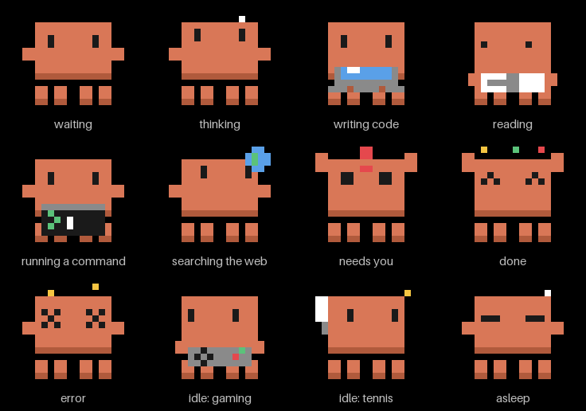

# Claudenotchi

A tiny pixel mascot that lives in your MacBook's notch and shows what [Claude Code](https://claude.com/claude-code) is doing, live. Thinking, writing code, running a command, waiting for you, done, failed: the mascot acts it out. When Claude needs permission, the notch opens and you can **Approve** or **Deny** without switching windows.



- **Native and light.** Swift and SwiftUI/AppKit, no Electron, no network access, 0% CPU while idle.
- **Reacts to real events.** It uses Claude Code's official [hooks](https://docs.claude.com/en/docs/claude-code/hooks), not screen scraping.
- **Permission prompts in the notch.** Approve or Deny a tool call from the notch; questions and plan approvals that need typing are flagged and left for the terminal.
- **Usage at a glance.** Hover to see the current task, the context window used (`context 83%`) and the estimated session cost.
- **Only there when needed.** The mascot appears when Claude Code starts and goes away when the last session ends (or its process dies); an option in the menu keeps it always visible.
- **Several sessions.** Every Claude Code session is tracked; the most urgent one drives the mascot.
- **Works without a notch.** On other displays it becomes a small pill at the top center.

## Requirements

- macOS 14 (Sonoma) or later, Apple silicon or Intel
- Claude Code with hooks support, including the `PermissionRequest` hook (developed against 2.1.300)
- A recent Xcode to build from source (developed with Xcode 27)

## Install

Download the latest `Claudenotchi-<version>.dmg` from the Releases page, drag the app to Applications and open it.

> Until the project has a notarized release, macOS may warn about an unidentified developer; open it from System Settings > Privacy & Security instead. Or build from source:

```sh
git clone https://github.com/Augusto-Ildefonso/claudenotchi.git
cd claudenotchi
scripts/release.sh          # unsigned universal build -> dist/Claudenotchi-<version>.dmg
```

or open `Claudenotchi.xcodeproj` in Xcode and run.

On first launch the app asks to install its hooks. This adds a small entry for each of Claude Code's hook events to `~/.claude/settings.json` (a timestamped backup is made first and existing hooks are left alone). **Uninstall Claude Code hooks** in the menu bar menu removes exactly those entries again.

Start (or restart) a Claude Code session and the mascot wakes up.

## How it works

```
Claude Code ──hook event──▶ claudenotchi-hook ──unix socket──▶ Claudenotchi.app ──▶ mascot
                         ◀────── Approve / Deny (permission requests only) ◀──────
```

`claudenotchi-hook` is a small helper that Claude Code runs for each hook event. It forwards the event to the app over a local Unix socket in your user folder and exits; for a permission request it waits for your answer and returns it to Claude Code. If the app is not running the helper exits silently and Claude Code carries on as usual, so Claudenotchi can never block your work.

Nothing leaves your Mac. The app has no network code. It reads the session transcript file that Claude Code already writes locally, to compute context use and cost.

## Menu bar options

| Option | What it does |
| --- | --- |
| Expand on hover | Delay before the panel opens: off, instantly, 0.25 to 3 s |
| Mascot size | Small 16 pt, Medium 24 pt (default), Large 32 pt |
| Show on | Automatic (the notched display), the main display, or a specific display |
| Hide when Claude isn't running | On by default: the pill is only shown while a Claude Code session is open |
| Play sounds | Soft sound cues for permission requests, completion and errors |
| Open at login | Starts the app when you log in |
| Install / Uninstall Claude Code hooks | Manages the entries in `~/.claude/settings.json` |

Clicking the permission panel brings the terminal running that session to the front. Selecting the exact tab is best effort and depends on the terminal (iTerm2 and Terminal.app are scripted, which makes macOS ask for automation permission the first time).

## Cost estimates

Costs are estimates from the token counts in the transcript and a built-in price table (`ModelCatalog`), including cache reads and writes. A model that is not in the table is counted in tokens but never priced; the figure then shows a trailing `+`. Prices change, so treat the number as a guide, not an invoice.

## Development

```sh
cd Packages/ClaudenotchiCore
swift test                  # the logic lives in this package; 300 tests
```

- `Claudenotchi/`: the app (notch window, SwiftUI views, menu bar, sprites, sounds)
- `Packages/ClaudenotchiCore/`: events, state machine, socket server and client, hook installer, geometry, usage and prices, and the `claudenotchi-hook` helper
- `scripts/fake-session.sh`: walks the app through every state without a real Claude Code session
- `scripts/gen_sprites.py`, `scripts/gen_sounds.py`: generate the pixel art and sounds from `art/sprites.json`; `scripts/make_preview.py` renders the GIF above; the app icon is designed in Figma, master in `art/icon/`
- `scripts/release.sh`: universal build and DMG; with `SIGN_IDENTITY` and `NOTARY_PROFILE` it also signs (hardened runtime) and notarizes
- `.claude/plans/mvp-plan.md`: the design plan and a log of what was built and verified

Running a second copy while another is active is refused so it can't steal the hook socket; for tests set `CLAUDENOTCHI_SOCKET` to a private path, and `-hooksSettingsPath <file>` to keep your real settings untouched.

## Not affiliated with Anthropic

Claudenotchi is an independent, unofficial project. "Claude" and "Claude Code" are trademarks of Anthropic, PBC. The mascot is a small pixel-art character inspired by the Claude Code terminal mascot.

## License

[MIT](LICENSE)
